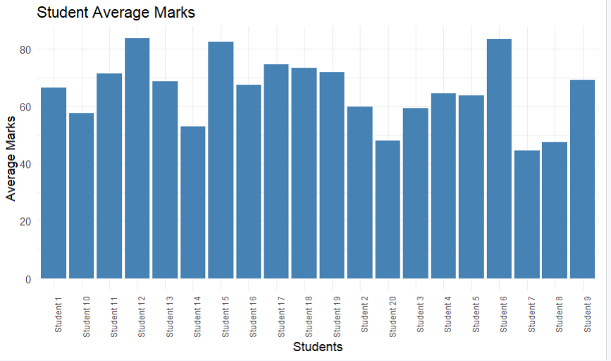

# Student-Performance-Analysis

This repository contains data analysis for student performance using R/Python. 

## Features
- Analyzes student scores and performance metrics.
- Visualizes data patterns and trends.

## Tech Stack
- R 
## Visualizations / Screenshots

